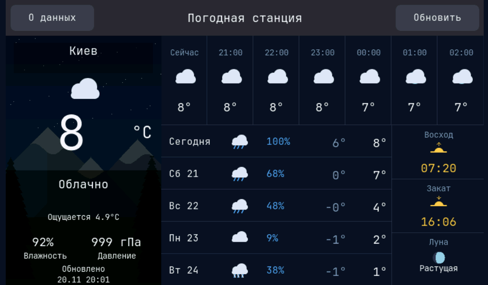
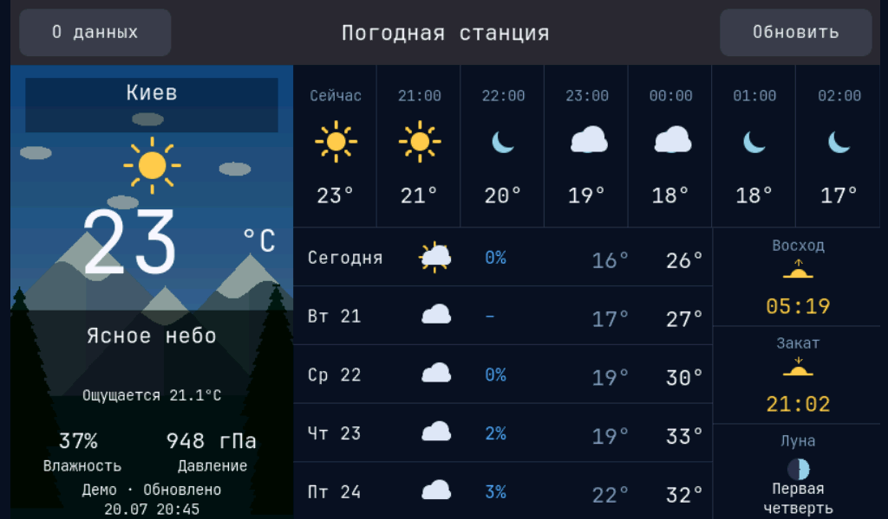
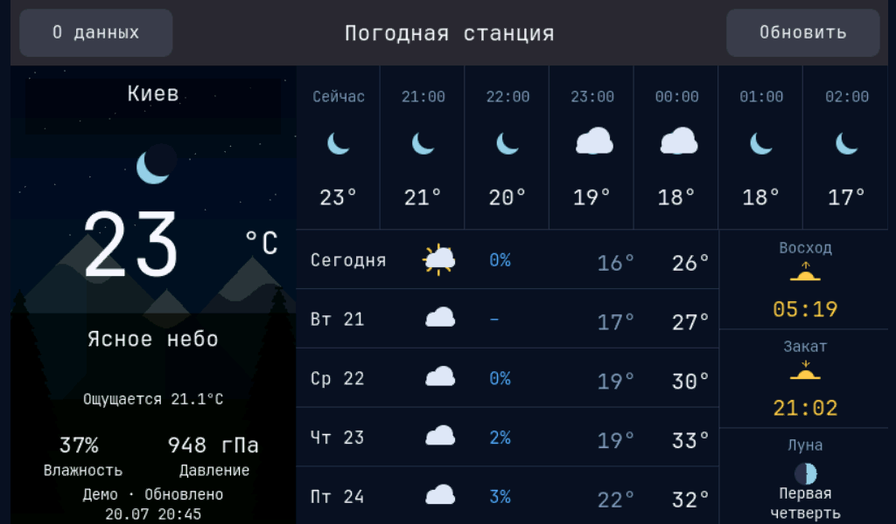
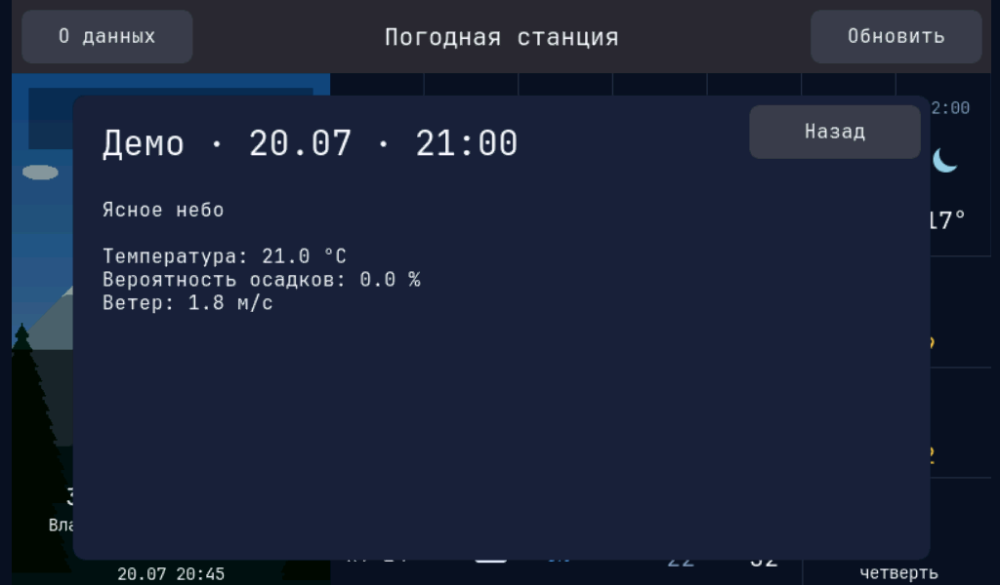
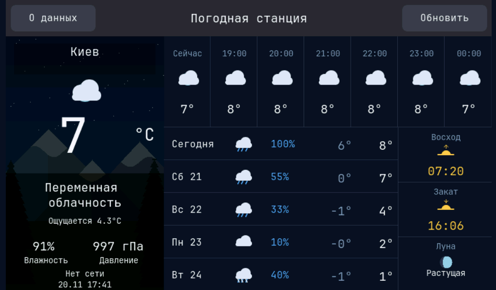

# Погодная станция ESP32-S3

Сенсорная погодная станция для Waveshare ESP32-S3 с RGB-экраном **1024 × 600**.
Получает прогноз Open-Meteo по Wi-Fi и показывает его на русском языке.
Прошивка и настольный предпросмотр используют один интерфейс LVGL.



Скриншот настольного предпросмотра с реальным ответом Open-Meteo, полученным
20 ноября 2026 года. Это тот же UI, что на устройстве, а не фотография платы.
Данные на изображении зафиксированы в момент съёмки.

## Что показывает станция

- Текущую температуру, ощущаемую температуру, влажность и давление.
- Ближайшие шесть часов и прогноз на пять дней.
- Вероятность осадков, ветер в карточке часа, минимум и максимум дня.
- Восход, закат и расчётную фазу Луны.
- Время последней загрузки, состояние сети и устаревание прогноза.

Карточки открываются касанием. Фоновые запросы не выполняются в обработчиках
интерфейса. При сбое сети остаётся последний корректный прогноз для выбранного
места. Файл конфигурации редактируется на компьютере; настроек на экране нет.

## Скриншоты

Дневной и ночной примеры ниже используют фиксированные демонстрационные данные
и помечены «Демо». В рабочем режиме фикстура не подменяет данные API.

| Дневной пример | Ночной пример |
| --- | --- |
|  |  |

| Карточка часа | Работа без сети с кешем |
| --- | --- |
|  |  |

[Все экраны и условия съёмки](docs/screenshots/README.md): карточка дня,
ошибки конфигурации, первый запуск без сети и проверки длинных значений.

## Аппаратная конфигурация

| Параметр | Значение |
| --- | --- |
| Профиль по умолчанию | `waveshare-lcd5b` |
| MCU | ESP32-S3 |
| Flash / PSRAM | 16 MB / 8 MB octal |
| Дисплей | RGB565, 1024 × 600, landscape |
| Touch / расширитель | GT911 / CH422G |
| Платформа | `espressif32@6.10.0`, ESP-IDF `5.4.0` |
| UI | LVGL `8.4.0`, JetBrains Mono |
| Файловая система | ESP LittleFS `1.19.1` |

Разрешение подтверждено регистрами работающей заводской прошивки. В проекте
есть отдельный профиль `waveshare-lcd5` для **800 × 480** — его тайминги
не подходят проверенному экрану 1024 × 600.

**Загрузчик записывается с заголовком DIO.** Во время работы он включает QIO.
Принудительный QIO при записи загрузчика уже приводил к чёрному экрану.
Пины, тайминги, reset и настройки памяти собраны в
[переносимом хендофе дисплея](docs/board-handoff.md).

## Сборка

Проверенная среда — macOS ARM64 с установленными UV, PlatformIO Core,
Command Line Tools и SDL2. CMake `3.30.5`, Ninja `1.11.1.3` и Python `3.12`
для настольной сборки запускаются через UV. Первичная сборка скачивает
закреплённые зависимости; пароль Wi-Fi для неё не нужен.

```sh
git clone git@github.com:shaposhnikoff/ESP32_S3_Weather_station_display.git
cd ESP32_S3_Weather_station_display

# Для стандартной установки PlatformIO Core:
export PATH="$HOME/.platformio/penv/bin:$PATH"

make firmware
make desktop
```

Результаты:

- `.pio/build/waveshare-lcd5b/firmware.bin` — приложение для платы.
- Рядом находятся `bootloader.bin` и `partitions.bin`.
- `build-desktop/weather-preview` — настольный предпросмотр.

Сборка прошивки идёт с `-j 1`: параллельная сборка SCons в проверенной среде
ранее работала нестабильно. Локальные сборки и приватные образы в Git не входят.

## Конфигурация и первый запуск

Единственный источник пользовательских настроек — внешний **`config.json`**.
Пример [config.example.json](config.example.json) задаёт Киев. В файле
указываются сеть Wi-Fi, локация, часовой пояс, яркость, интервалы и режим.

```sh
install -d -m 700 "$HOME/.local/share/weather-station/config"
CONFIG="$HOME/.local/share/weather-station/config/config.json"
if [ ! -e "$CONFIG" ]; then
  cp config.example.json "$CONFIG"
fi
chmod 600 "$CONFIG"

# Отредактируй файл, затем проверь его:
./build-desktop/weather-config-check "$CONFIG"
```

Все поля обязательны. Неверные типы, неизвестные поля и повреждённый JSON
отклоняются. Изменения применяются после перезапуска без пересборки.

Режимы:

- `weather` — реальная погода; на плате подключается настроенная сеть Wi-Fi.
- `demo` — явно помеченная фикстура, без сети и записи в рабочий кеш.
- `diagnostics` — проверка дисплея и координат касания.

На компьютере используется подключение к интернету самой ОС:

```sh
./build-desktop/weather-preview --config "$CONFIG"
./build-desktop/weather-preview --config "$CONFIG" --screenshot weather.bmp
```

Без файла или при ошибке обязательного поля UI предлагает исправить внешний
файл. В прошивке нет встроенного пароля, captive portal и резервных настроек
в NVS. Не добавляй настоящий файл и его Flash-образ в репозиторий.

## Запись на плату

В [пошаговой инструкции](docs/deployment.md) описаны:

1. Первоначальная запись согласованного комплекта загрузчика, таблицы и приложения.
2. Размещение всего `config.json` в отдельном разделе LittleFS.
3. Обновление одного приложения с сохранением настроек и кеша.
4. Проверка serial-лога и восстановление после неудачной записи.

Помощник для загрузки конфигурации на проверенной установке PlatformIO:

```sh
pio device list
sh tools/provision-config.sh "$CONFIG" /dev/cu.usbmodemXXXX
pio device monitor --port /dev/cu.usbmodemXXXX --baud 115200
```

Он рассчитан на Python в `$PLATFORMIO_CORE_DIR/penv/bin/python`.
Для другой установки выбор интерпретатора и ручная запись описаны в инструкции.
При переходе с другого проекта нужна совместимая таблица разделов:
одного `firmware.bin` может быть недостаточно.

## Проверки и статус

```sh
uv tool run --python 3.12 --from cmake==3.30.5 \
  --with ninja==1.11.1.3 ctest --test-dir build-desktop --output-on-failure
```

15 автоматических проверок охватывают конфигурацию, разбор данных, часовые пояса,
Луну, кеш, повторы запросов, контролируемые сетевые сбои и навигацию на двух
разрешениях. Выполнена также проверка с ASan/UBSan. Сетевые тесты подменяют
транспорт; они не эмулируют радиомодуль ESP32.

Финальная сборка записана на плату: проверены хеши образов, DIO boot,
8 MB PSRAM, подключение Wi-Fi и HTTP 200 от Open-Meteo. Пользователь ранее
подтвердил видимый погодный экран. Длительная стабильность, калибровка касаний
по всем углам и перебои радиосвязи под нагрузкой отдельно не подтверждены.

OTA пока **не реализовано**. Обновление по Wi-Fi с двумя слотами и откатом
добавлено в [будущие задачи](tasks/todo.md).

## Структура проекта и документация

| Путь | Содержимое |
| --- | --- |
| `firmware/main/`, `include/` | Запуск ESP32, драйверы и профиль платы |
| `components/weather_data/` | Модель, Open-Meteo, время, кеш и повторы |
| `components/weather_app/` | Проверка единого файла конфигурации |
| `components/weather_ui/`, `assets/` | Общий UI, иконки, шрифты и пейзажи |
| `desktop/`, `fixtures/`, `tests/` | SDL-предпросмотр и проверки |
| [deployment.md](docs/deployment.md) | Сборка, настройка, запись и восстановление |
| [board-handoff.md](docs/board-handoff.md) | Параметры рабочего дисплея для другого проекта |
| [station-flow.md](docs/diagrams/station-flow.md) | Mermaid-схема работы станции |
| [release.md](docs/release.md) | Подробные результаты сборок и ограничения |
| [handoff.md](docs/handoff.md) | История разработки и передачи этапов |

## Данные и ресурсы

Погодные данные предоставляет **Open-Meteo**; атрибуция отображается в «О данных».
Фаза Луны рассчитывается по методу SunCalc. Пейзажи и погодные иконки созданы
для проекта; шрифт JetBrains Mono распространяется по SIL OFL.
Подробности и тексты сторонних лицензий:
[third-party-licenses.md](docs/third-party-licenses.md), [assets/README.md](assets/README.md).
