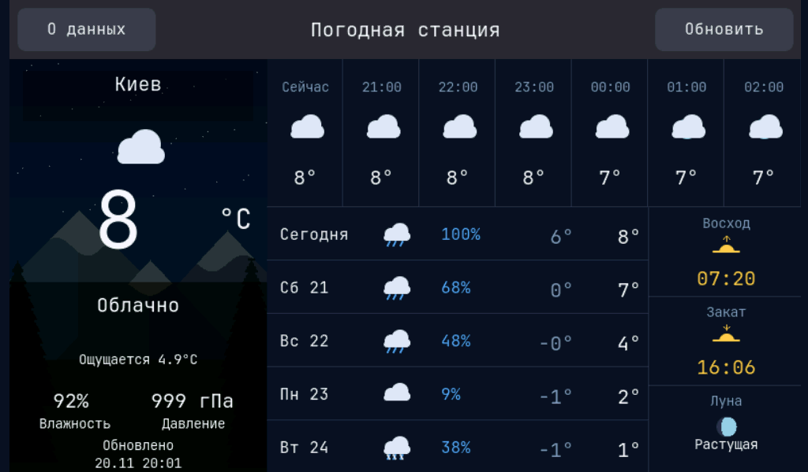
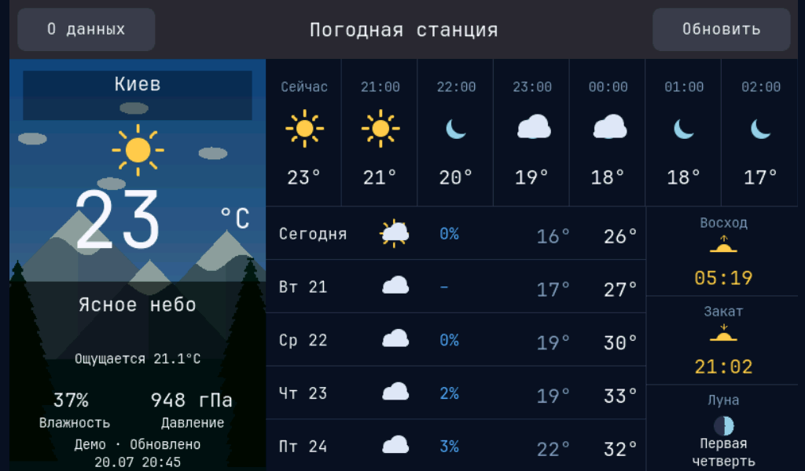
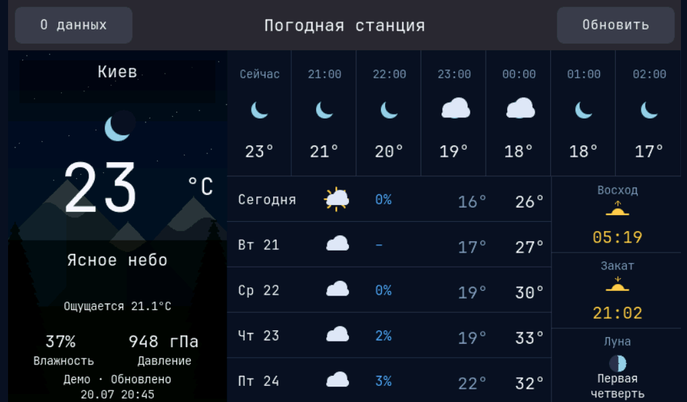
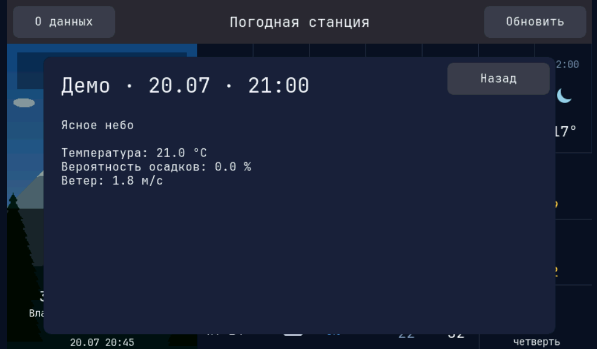
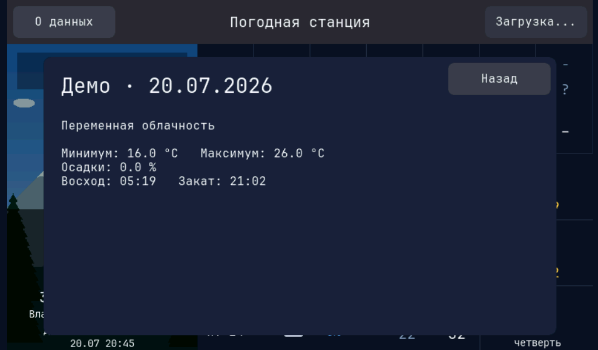
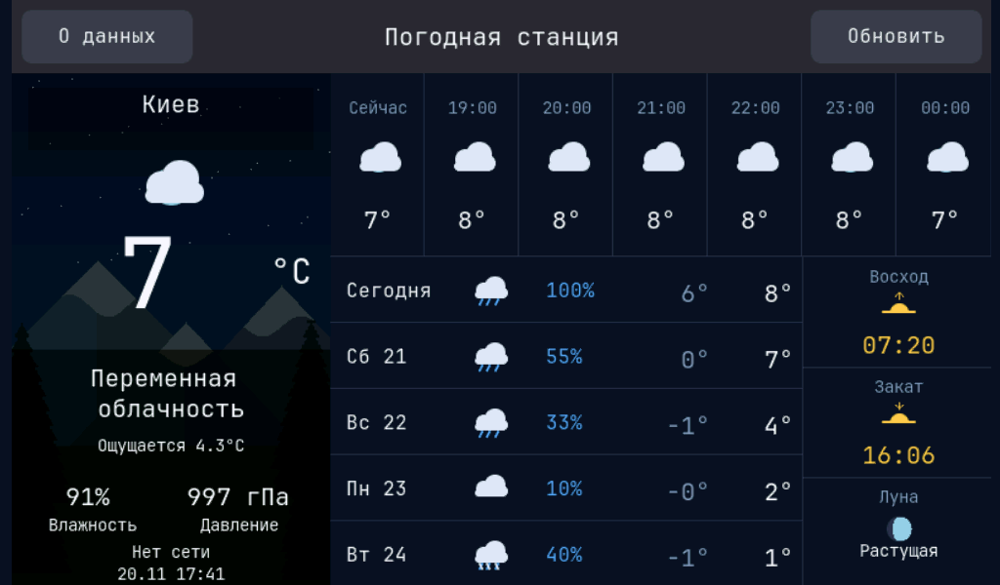
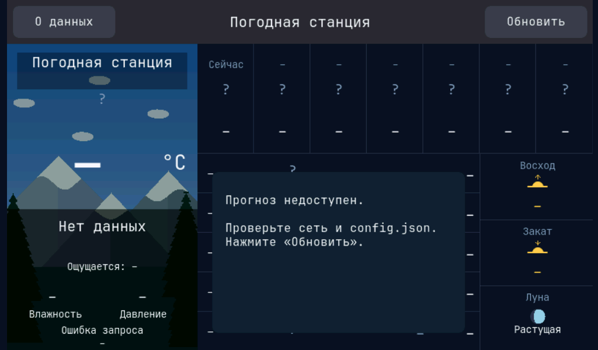
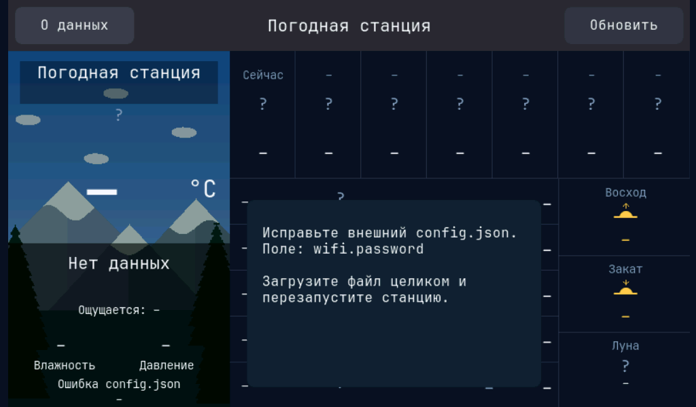

# Экраны погодной станции

Все изображения здесь — снимки **настольного предпросмотра общего LVGL UI**.
Фотографии физического LCD не выдаются за скриншоты. Прошивка использует те же
компоненты интерфейса, шрифты и изображения.

Физический профиль — 1024 × 600. Композиция 800 × 480 масштабируется до
1000 × 600 и центрируется с полями по 12 пикселей.

## Реальный прогноз



`live-1024x600.png` получен 20 ноября 2026 года отдельным запуском preview
с внешним `config.json`, без предварительного кеша. Журнал подтвердил HTTP 200
и 7,5 °C. Изображение фиксирует данные на момент съёмки; оно не обновляется
вместе с текущей погодой. Реквизиты Wi-Fi на изображении отсутствуют.

## Дневной и ночной примеры





Оба примера используют `fixtures/demo.json` и замороженное время.
Метка «Демо» видна на экране. Ночной вариант дополнительно задаёт ночные
иконки в тестовом снимке, чтобы проверить ночное оформление.
Демонстрационный режим не подменяет реальный прогноз при ошибке сети.

## Карточки часа и дня





Карточки открыты настоящими SDL pointer events в проверках общего UI.
Возврат проверяется кнопкой «Назад» и Escape. Карточка дня показана в состоянии
фонового обновления: выбранная карточка остаётся открытой.

## Нет сети, но есть сохранённый прогноз



Внешний файл конфигурации загружен при старте. Сетевой запрос направлен через
недоступный локальный прокси; на экране остаётся ранее полученный реальный
прогноз, его время загрузки и состояние «Нет сети».

## Первый запуск без интернета



Новых значений не выдумывается: вместо температуры и прогноза показаны прочерки.

## Ошибка конфигурации



В проверочном файле `wifi.password` имел неверный тип. UI показывает имя поля,
предлагает заменить весь внешний файл и перезапустить станцию. Значение
пароля в сообщение не включается.

## Дополнительные состояния

В этом каталоге также сохранены примеры 800 × 480: `loading.png`,
`updating.png`, `stale.png`, `partial.png`, `long-location.png`,
`winter.png`, `large-three-digit.png`, `icon-gallery.png` и `about-data.png`.
Это детерминированные тестовые состояния, а не реальные наблюдения погоды.

`external-config-changed-1024.png` показывает применение изменённого названия,
яркости и крупного текста после запуска с другим файлом без пересборки.
`location-change-1024.png` показывает отказ использовать кеш от другой локации.

## Как повторить снимки

Для произвольного запуска с настоящими данными:

```sh
SDL_VIDEODRIVER=dummy ./build-desktop/weather-preview \
  --config /private/path/config.json --screenshot weather.bmp
```

Обычный `make desktop` создаёт preview 800 × 480. Для preview 1024 × 600
сконфигурируй сборку с `-DWEATHER_PREVIEW_NATIVE=ON`.
Нативные тестовые снимки создаёт `weather-ui-native-tests`:

```sh
SDL_VIDEODRIVER=dummy ./build-desktop/weather-ui-native-tests \
  fixtures/demo.json build-desktop/screenshots-native
```

BMP можно преобразовать в PNG системной утилитой macOS:

```sh
sips -s format png weather.bmp --out weather.png
```
